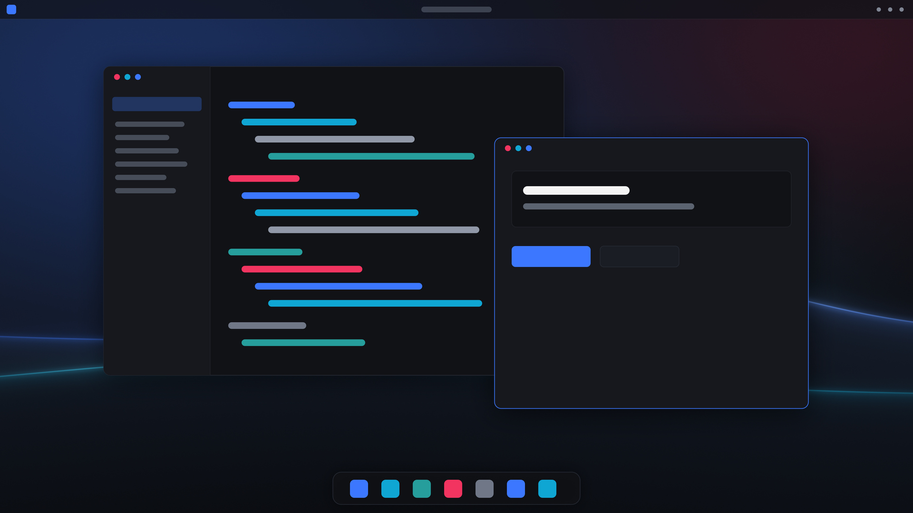

<div align="center">



# Aether Theme Suite

*A unified, deep obsidian desktop & developer theme suite with electric royal blue and cyan accents.*

<br/>

`#111216` &nbsp;✦&nbsp; `#16181d` &nbsp;✦&nbsp; `#3c78ff` &nbsp;✦&nbsp; `#10a6d4` &nbsp;✦&nbsp; `#269e9c` &nbsp;✦&nbsp; `#f13460`

<br/>

[Palette](palette/) · [Components](#coverage) · [Installation](#installation) · [License](LICENSE)

</div>

---

## Overview

**Aether** synchronizes your Linux desktop, editors, terminals, and CLI tools into one cohesive **Deep Obsidian** aesthetic with translucent glass surfaces, crisp typography, and high-contrast electric accents.

* **Palette:** Deep Obsidian (`#111216`) · Surface (`#16181d`) · Royal Blue (`#3c78ff`) · Electric Cyan (`#10a6d4`) · Teal (`#269e9c`) · Crimson (`#f13460`) · Electric Violet (`#a673f5`)
* **Canonical Source:** [`palette/palette.json`](palette/palette.json)
* **Typography:** `Google Sans` (Desktop / UI) · `JetBrainsMono Nerd Font` (Code / Terminal)
* **Font Rendering:** RGB Subpixel Antialiasing · Slight Hinting

---

## Coverage

| Component | Target | Included |
| :--- | :--- | :--- |
| **Palette** | All Ports | [`palette/`](palette/) — `palette.json`, `palette.css`, ANSI & semantic tokens |
| **Desktop** | KDE Plasma 6 | Global Theme (`Look & Feel`), Color Scheme (`Aether.colors`), Desktop Theme, 4K Wallpaper |
| **Widgets** | Kvantum Engine | `Aether` translucent SVG theme (`kvantum-dark`) |
| **Windows** | Aurorae v2 | `Aether` minimalist borderless window decoration |
| **Apps** | GTK 3 · GTK 4 · Libadwaita | `Aether-Dark` GTK theme + user CSS overrides |
| **Editors** | VS Code · VSCodium · Zed | `lumexren.aether-dark` extension (`.vsix` + source) & `zed/aether.json` |
| **Terminals** | Konsole · Fish · Zsh · Bash | `Aether.colorscheme` + FZF Aether colors |
| **CLI & TUI** | Btop · Bat · Starship · Delta | System monitor theme, prompt, `Aether Dark.tmTheme` & Git diff styling |
| **Fonts** | Fontconfig | Subpixel RGB & crisp desktop/code font configuration |

---

## Installation

Clone the repository and run the installer:

```bash
git clone https://github.com/lumexren/aether-theme-suite.git
cd aether-theme-suite
./install.sh
```

Useful installer flags:

```bash
./install.sh --dry-run                   # Preview changes without touching files
./install.sh --only plasma,konsole,bat   # Install selected components only
./install.sh --skip plasma               # Skip specific components
./install.sh --with-shell-aliases        # Also add `alias cat="bat --paging=never"`
./install.sh --uninstall                 # Remove Aether files & restore backups
```

> [!NOTE]
> `install.sh` backs up overwritten configs under `~/.local/state/aether-theme-suite/backups/` and applies Plasma 6, Kvantum, Aurorae, GTK 3/4, Konsole, VS Code/VSCodium/Antigravity/Cursor, Zed, Starship, Btop, Bat (`Aether Dark.tmTheme`), Delta, and Fish/Zsh/Bash FZF settings for the current user.

### Recommended Dependencies

* **KDE Plasma 6** + **Kvantum** (`kvantum-dark` widget style)
* **Icons & Cursor:** `Papirus-Dark` and `Bibata-Modern-Ice`
* **Fonts:** `Google Sans` and `JetBrainsMono Nerd Font`
* **CLI Tools:** `starship`, `btop`, `bat`, `git-delta`, `fzf`

---

## Repository Structure

```text
aether-theme-suite/
├── palette/         # Canonical color & typography tokens (palette.json, palette.css)
├── plasma/          # KDE Plasma 6 (look-and-feel, desktoptheme, color-schemes, aurorae, kvantum, wallpaper)
├── gtk/             # Aether-Dark GTK 3/4 theme & Libadwaita overrides
├── vscode/          # Aether Dark VS Code extension source, .vsix package & preset
├── zed/             # Zed editor theme (aether.json)
├── konsole/         # Konsole color scheme
├── starship/        # Starship prompt config
├── btop/            # Btop system monitor theme
├── bat/             # Bat config & Aether Dark.tmTheme
├── fontconfig/      # Font rendering configs
├── scripts/         # Palette sync/validation & VSIX packaging scripts
├── Makefile         # `make check`, `make sync`, `make package-vscode`
└── install.sh       # Modular installer with backups & --uninstall
```

---

## License

Released under the [MIT License](LICENSE).
